<p align="center"></p>

<p align="center">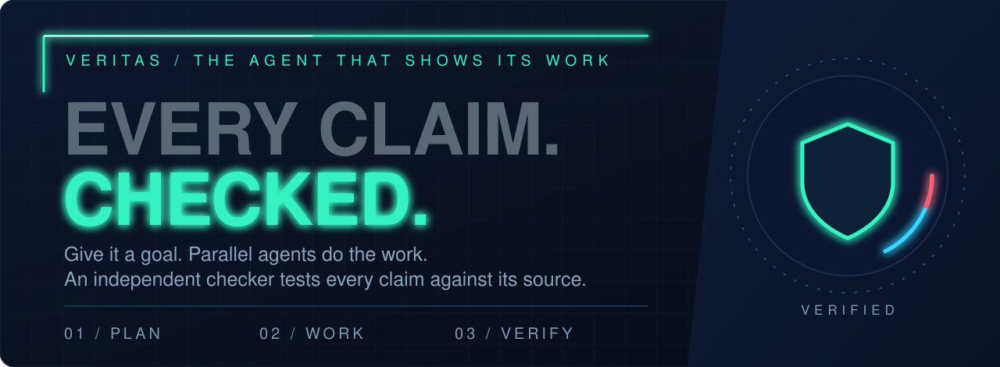</p>

<p align="center">
  <a href="#see-it-work">See it work</a> ·
  <a href="#what-it-does">What it does</a> ·
  <a href="#a-real-report">A real report</a> ·
  <a href="#quick-start">Quick start</a> ·
  <a href="#measured-not-promised">Measured, not promised</a> ·
  <a href="docs/PRODUCT.md">Product</a> ·
  <a href="docs/plan/BUILD-PLAN.md">Plan</a>
</p>

<p align="center">
  
  
  
  
</p>

**Veritas is an AI task agent that shows its work.** You give it a goal. A planner splits it into tasks, parallel agents do them, and an independent checker tests every claim against its source before a cited result is written. What fails the check is removed, and the report says so.

It does research reports, analysis of your own files and data, and code changes. Today it is a command-line tool that runs on your own Claude Code login. A visual app and a hosted service come later.

<br>

<a id="see-it-work"></a>
<p align="center">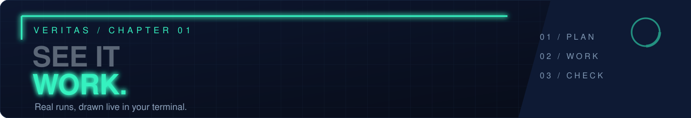</p>

Both recordings are the real terminal view, drawn from the events of real runs. Waiting time is shortened; every number in them was recorded.

**A data question.** An agent writes the analysis code, Veritas runs it in a sandbox, and eight claims are checked and confirmed:

<p align="center"></p>

**A code change.** The agent works in a separate copy of your repository. Veritas runs the tests itself: failing before, passing after. Your own folder is not touched:

<p align="center"></p>

<br>

<a id="what-it-does"></a>
<p align="center">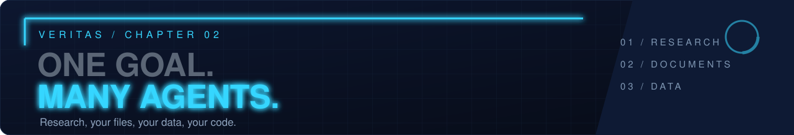</p>

<p align="center">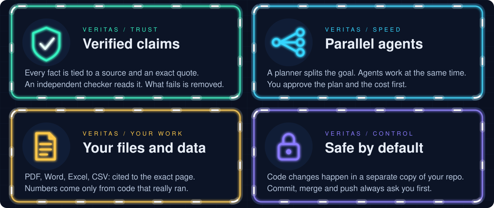</p>

<p align="center">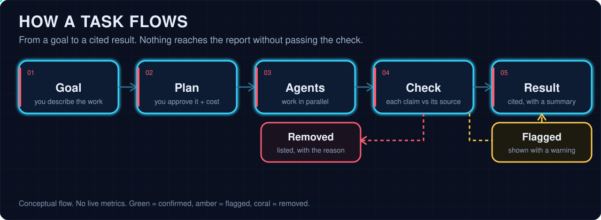</p>

<a id="a-real-report"></a>
### A real report

This is an excerpt of the output of the data run above. Every number in the table is a stored result of code that ran, and each cell cites a checked claim. The report also carries the code, a chart and the full verification summary: [read the whole report](docs/assets/sample-report.md).

<p align="center">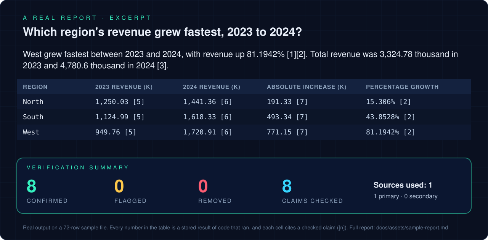</p>

<br>

<a id="quick-start"></a>
<p align="center">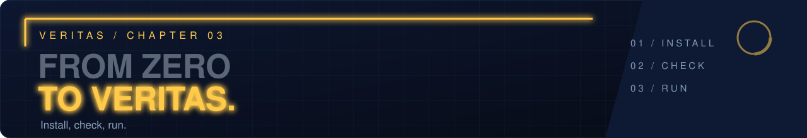</p>

You need Node.js 22.13 or newer and [Claude Code](https://claude.com/claude-code), logged in. Veritas is not published yet (a packaged install, `npm install -g veritas-cli@0.1.0`, is prepared and tested; see [`docs/RELEASING.md`](docs/RELEASING.md)), so for now run it from this folder:

```
npm ci
npm run build
node bin/veritas.js doctor        # checks Node, your Claude login and the data folder
```

Then try one of these (add `--budget 1` to cap the spending at one dollar):

```
# research, with a cited report
node bin/veritas.js run "How has the price of solar panels changed since 2015?" --budget 1

# questions about your own files: every statement cites the exact page
node bin/veritas.js run "What are the termination terms?" --file contract.pdf

# data analysis: the AI writes the code, Veritas runs it in a sandbox, numbers come only from that run
node bin/veritas.js setup         # once; asks before installing anything
node bin/veritas.js run "Which region grew fastest?" --file sales.csv

# code: the change is made in a separate copy; your files are not touched
node bin/veritas.js code "Fix the failing test" --repo ~/projects/app
```

Before anything runs you see the plan and a cost estimate and you approve it.

<details>
<summary><b>All commands</b></summary>

<br>

| Command | What it does |
|---|---|
| `run`, `plan`, `code` | Do a task, only plan it, or make a code change in a separate copy. |
| `list`, `status`, `show <task>` | See your tasks. `show <task> --claims` lists every claim and whether it was confirmed, flagged or removed; `--claim 3` shows its source, exact quote and checks. |
| `export <task> --as pdf` | Save a finished report as Markdown, Word (`docx`) or PDF. |
| `cost` | What you have spent, by day, task and model. |
| `apply <task>` | Keep a coding task's change: save it as a commit, or with `--merge` / `--pr` merge it or open a pull request. Each step asks first. |
| `discard <task>` | Throw away a coding task's separate copy. |
| `memory` | See, search or erase what Veritas remembers between tasks. |
| `approve`, `resume`, `cancel` | Decide a waiting question, continue a paused task, or stop one. |
| `config`, `doctor`, `setup` | Settings, health check, and the analysis sandbox. |

</details>

<br>

<a id="measured-not-promised"></a>
<p align="center">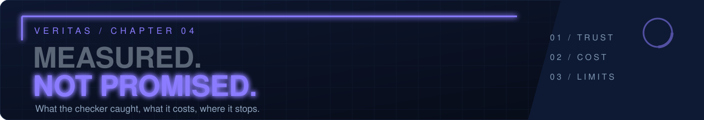</p>

Verification confirms that a claim **matches its source**. It does not prove the source is right. Here is what has been measured, with the methods in [`docs/eval`](docs/eval).

<p align="center">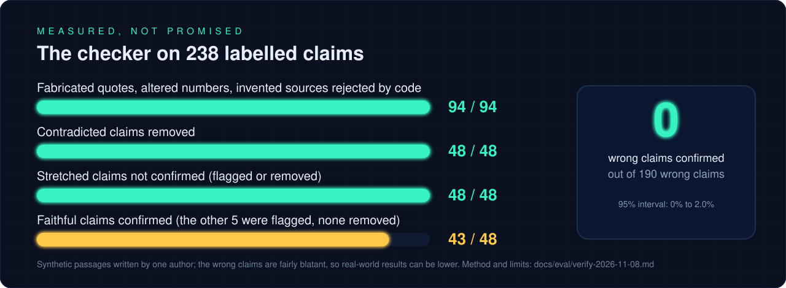</p>

<p align="center">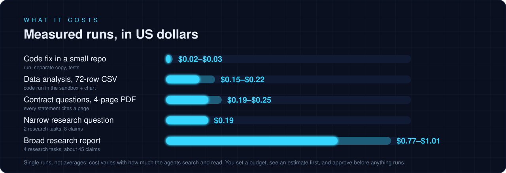</p>

- **Exact checks are code, not AI.** A cited page must have been fetched by Veritas itself, the quote must be on it, and the numbers must match.
- **An independent AI checker** then reads each surviving claim and its quote and judges whether they support it. That step is good but not perfect, and the test claims were fairly blatant. Real pages are messier.
- **Numbers from data come only from code that ran** in a sandbox with no network, and the code is included in the report.
- **Code changes** are made in a separate git worktree. "Tests passed" appears only if Veritas ran the tests itself and they exited cleanly. Commit, merge and push always ask you first.

**Known limits:** scanned PDFs with no text layer are refused; numbers written as words ("fivefold") are checked only by the AI checker; project test commands run unsandboxed with your privileges after you approve them once; the Docker sandbox backend has never been run against real Docker; opening a pull request needs the `gh` tool and has not been tested live. The full list is in [`docs/eval`](docs/eval) and [`CLAUDE.md`](CLAUDE.md).

<br>

## Status

Version 0.1.0, built and tested by one person on macOS. The command-line tool covers research, documents, data analysis and coding. Not built yet: the visual app, the hosted service and plans. See [`docs/PRODUCT.md`](docs/PRODUCT.md) for the product definition and [`docs/plan/BUILD-PLAN.md`](docs/plan/BUILD-PLAN.md) for the plan.

<details>
<summary><b>Development</b></summary>

<br>

```
npm ci
npm run build
npm test                   # unit and end-to-end tests with a fake agent runtime
npm run eval:verify        # measures the claim checker on the labelled set (uses the real model, about $0.10)
npm run probe:permissions  # checks what an agent can reach with Veritas's permission rules
npm run art                # regenerates the graphics in docs/assets
```

</details>

## License

Apache-2.0
