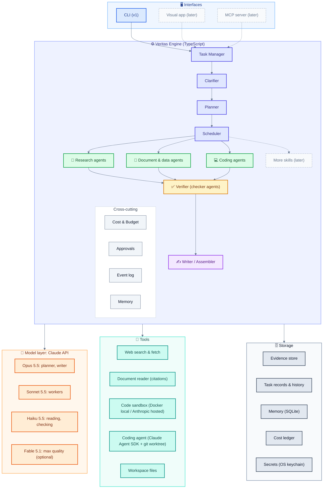
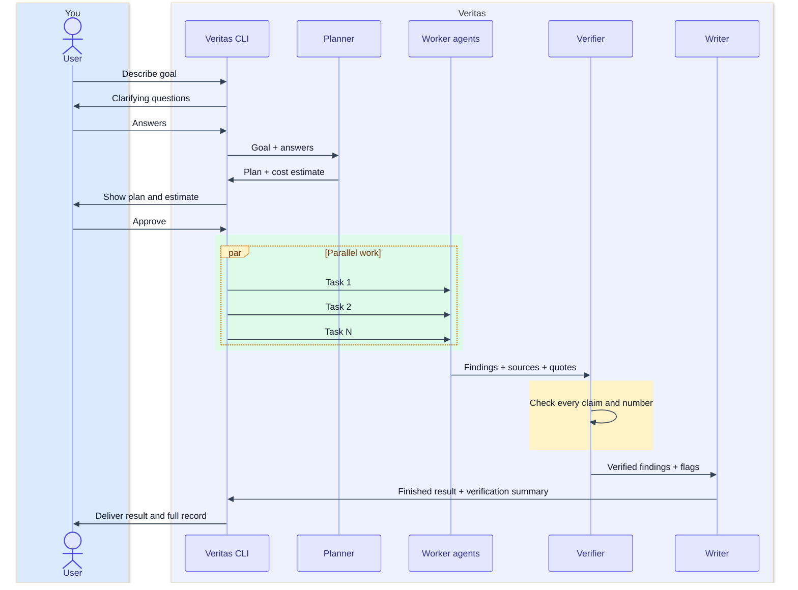
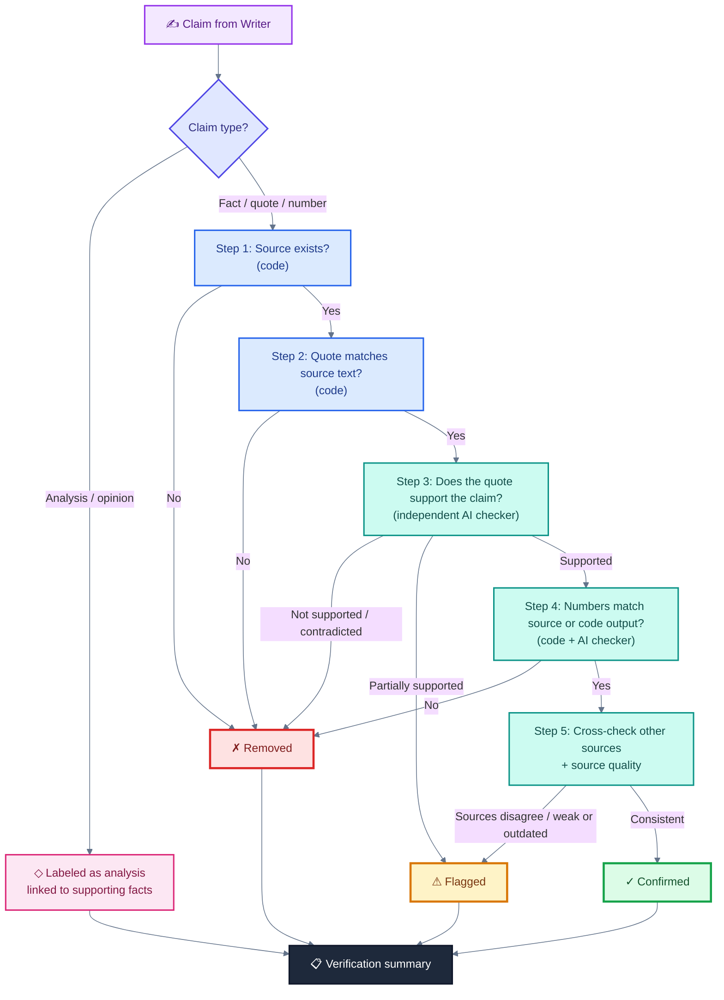
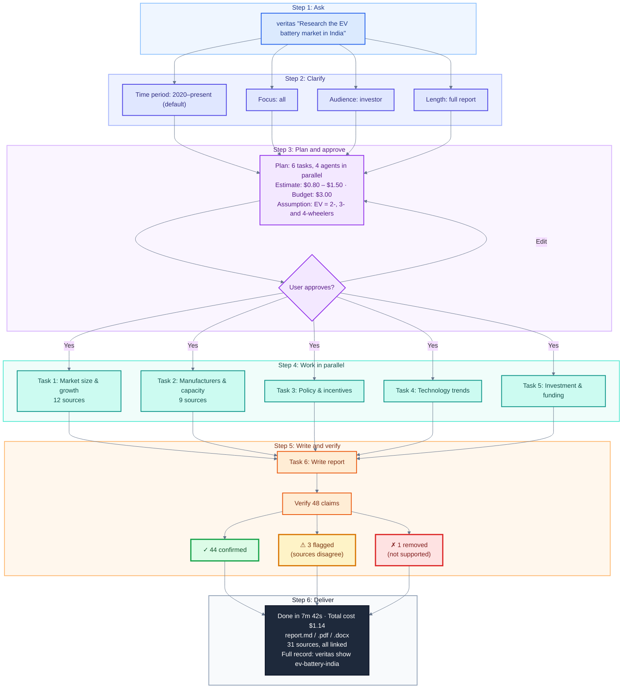
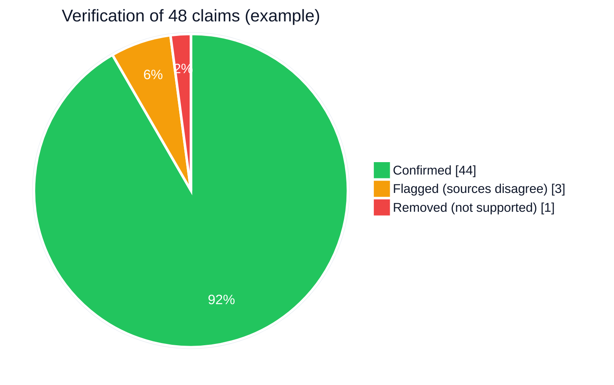

# Veritas — Diagrams

Mermaid source for Veritas diagrams. Paste any block into https://mermaid.live to view or export as PNG/SVG. GitHub renders these automatically.

**Colour key (used across diagrams):** blue = interfaces · indigo = engine · green = worker agents / confirmed · amber = verification / flagged · purple = writer / analysis · orange = AI models · teal = tools · slate = storage · red = removed.

---

## 1. System Architecture

---

## 2. Task Flow (one task, start to finish)

---

## 3. Verification Pipeline (one claim)

*Blue = checked by plain code · teal = checked by an AI checker.*

---

## 4. Example Walkthrough: Research Report (Section 8.2)

> Illustrative only. The numbers, sources and costs are examples, not real measurements.

---

## 5. Example Verification Results (Section 8.2)

> Illustrative only.

