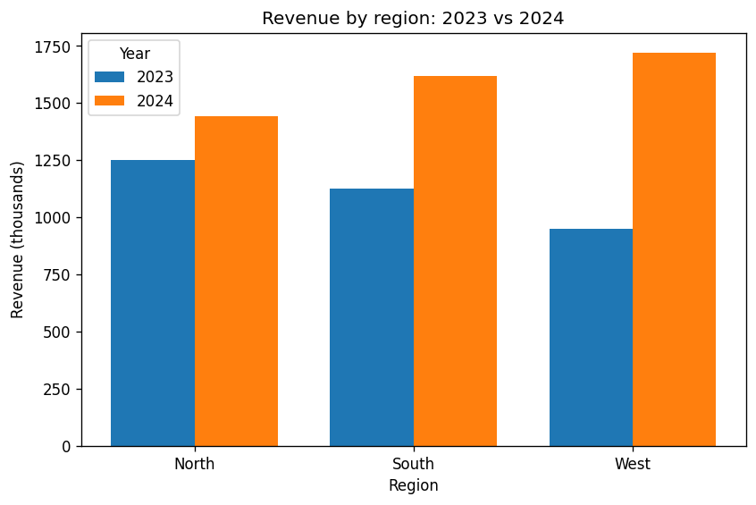

# Which region's revenue grew fastest between 2023 and 2024, and what was total revenue in each year? Include a chart.

## Assumptions

- "Grew fastest" means highest percentage growth in revenue from 2023 to 2024; absolute increase is reported too in case it gives a different answer.
- Years are calendar years taken from the date or year field in sales.csv.
- Total revenue for each year is the sum across all regions in sales.csv.
- The chart is a grouped bar chart comparing each region's revenue in 2023 and 2024.

## Answer

West grew fastest between 2023 and 2024, with revenue up 81.1942% [1][2]. Total revenue was 3,324.78 thousand in 2023 and 4,780.6 thousand in 2024 [3].

West also had the largest absolute increase, 771.15 thousand, so both ways of measuring growth give the same answer [4].

## Revenue by region

| Region | 2023 revenue (thousands) | 2024 revenue (thousands) | Absolute increase (thousands) | Percentage growth |
|---|---|---|---|---|
| North | 1,250.03 [5] | 1,441.36 [6] | 191.33 [7] | 15.306% [2] |
| South | 1,124.99 [5] | 1,618.33 [6] | 493.34 [7] | 43.8528% [2] |
| West | 949.76 [5] | 1,720.91 [6] | 771.15 [7] | 81.1942% [2] |

Every region's revenue rose [7].

Analysis: West had the lowest revenue of the three regions in the first year and the highest in the second, so its lead in growth changed the regional ranking.

A grouped bar chart below compares each region's revenue in 2023 and 2024 [5][6].

## Data quality

All 72 rows were used: none had unparseable revenue or dates or a missing region, and none were dropped [8]. No region appeared in only one year [8].

Totals use the revenue column given in thousands, summed by calendar year from the month field [3].

## Sources

1. Analysis run run_030c253f — code in the appendix (computed by code that ran in the sandbox)
   > fastest_growth_region: West ... fastest_growth_pct: 81.1942
2. Analysis run run_030c253f — code in the appendix (computed by code that ran in the sandbox)
   > pct_growth_by_region.North: 15.306 ... pct_growth_by_region.South: 43.8528 ... pct_growth_by_region.West: 81.1942
3. Analysis run run_030c253f — code in the appendix (computed by code that ran in the sandbox)
   > revenue_formula: revenue_k column used directly (revenue in thousands, summed by calendar year from month YYYY-MM) ... total_revenue_k_2023: 3324.78 ... total_revenue_k_2024: 4780.6
4. Analysis run run_030c253f — code in the appendix (computed by code that ran in the sandbox)
   > largest_abs_increase_region: West ... largest_abs_increase_k: 771.15 ... largest_abs_same_as_fastest: yes
5. Analysis run run_030c253f — code in the appendix (computed by code that ran in the sandbox)
   > revenue_k_2023_by_region.North: 1250.03 ... revenue_k_2023_by_region.South: 1124.99 ... revenue_k_2023_by_region.West: 949.76
6. Analysis run run_030c253f — code in the appendix (computed by code that ran in the sandbox)
   > revenue_k_2024_by_region.North: 1441.36 ... revenue_k_2024_by_region.South: 1618.33 ... revenue_k_2024_by_region.West: 1720.91
7. Analysis run run_030c253f — code in the appendix (computed by code that ran in the sandbox)
   > abs_change_k_by_region.North: 191.33 ... abs_change_k_by_region.South: 493.34 ... abs_change_k_by_region.West: 771.15
8. Analysis run run_030c253f — code in the appendix (computed by code that ran in the sandbox)
   > rows_total: 72 ... rows_unparseable_revenue: 0 ... rows_unparseable_date: 0 ... rows_missing_region: 0 ... rows_dropped: 0 ... regions_in_only_one_year: none

## Charts



*Chart captions are the analysis agent's description of the picture and are not checked; the numbers behind a chart are in the code below.*

## Verification summary

- Claims checked: 8
- ✓ Confirmed: 8
- ⚠ Flagged: 0
- ✗ Removed: 0
- ◇ Analysis sentences: 1 (labelled as reasoning, not sourced fact)
- Sources used: 1 (1 primary · 0 secondary · 0 unrated · 0 low-confidence)

"Confirmed" means the cited page was fetched by Veritas, the quote is on it, the numbers match and an independent checker agreed the quote supports the claim. It does not prove the page itself is correct.

## Code

This is the code that produced the computed numbers. Veritas ran it in a sandbox with no network access; the figures in the report are the values it wrote. Save it and the input files together to run it again.

Run 030c253f7a4e (attempt 1, sandbox-exec sandbox):

```python
import json, os, math
import pandas as pd
import numpy as np
import matplotlib
matplotlib.use("Agg")
import matplotlib.pyplot as plt

os.makedirs("output", exist_ok=True)
df = pd.read_csv("input/sales.csv")
print("columns:", list(df.columns), "rows:", len(df))

total_rows = len(df)
df["revenue_k"] = pd.to_numeric(df["revenue_k"], errors="coerce")
dates = pd.to_datetime(df["month"], format="%Y-%m", errors="coerce")
df["year"] = dates.dt.year
df["region"] = df["region"].astype("string").str.strip()

bad_rev = int(df["revenue_k"].isna().sum())
bad_date = int(df["year"].isna().sum())
bad_region = int(df["region"].isna().sum())
clean = df.dropna(subset=["revenue_k", "year", "region"]).copy()
clean["year"] = clean["year"].astype(int)
dropped = total_rows - len(clean)
print("rows dropped:", dropped)

clean = clean[clean["year"].isin([2023, 2024])]
pivot = clean.pivot_table(index="region", columns="year", values="revenue_k",
                          aggfunc="sum")
for y in (2023, 2024):
    if y not in pivot.columns:
        pivot[y] = np.nan

only_one = [r for r in pivot.index if pd.isna(pivot.loc[r, 2023]) or pd.isna(pivot.loc[r, 2024])]
both = pivot.dropna(subset=[2023, 2024]).copy()
both["abs_change"] = both[2024] - both[2023]
both["pct_growth"] = both["abs_change"] / both[2023] * 100

def clean_num(x):
    x = float(x)
    return None if (math.isnan(x) or math.isinf(x)) else round(x, 4)

tot23 = clean_num(clean.loc[clean["year"] == 2023, "revenue_k"].sum())
tot24 = clean_num(clean.loc[clean["year"] == 2024, "revenue_k"].sum())

res = {
    "revenue_formula": "revenue_k column used directly (revenue in thousands, summed by calendar year from month YYYY-MM)",
    "total_revenue_k_2023": tot23,
    "total_revenue_k_2024": tot24,
    "revenue_k_2023_by_region": {r: clean_num(v) for r, v in both[2023].items()},
    "revenue_k_2024_by_region": {r: clean_num(v) for r, v in both[2024].items()},
    "abs_change_k_by_region": {r: clean_num(v) for r, v in both["abs_change"].items()},
    "pct_growth_by_region": {r: clean_num(v) for r, v in both["pct_growth"].items()},
    "rows_total": total_rows,
    "rows_unparseable_revenue": bad_rev,
    "rows_unparseable_date": bad_date,
    "rows_missing_region": bad_region,
    "rows_dropped": dropped,
    "regions_in_only_one_year": ", ".join(only_one) if only_one else "none",
}
if len(both):
    top = both["pct_growth"].idxmax()
    big = both["abs_change"].idxmax()
    res["fastest_growth_region"] = str(top)
    res["fastest_growth_pct"] = clean_num(both.loc[top, "pct_growth"])
    res["largest_abs_increase_region"] = str(big)
    res["largest_abs_increase_k"] = clean_num(both.loc[big, "abs_change"])
    res["largest_abs_same_as_fastest"] = "yes" if top == big else "no"

with open("output/results.json", "w") as f:
    json.dump(res, f, indent=2)

fig, ax = plt.subplots(figsize=(8, 5))
x = np.arange(len(both))
w = 0.38
ax.bar(x - w/2, both[2023].values, w, label="2023")
ax.bar(x + w/2, both[2024].values, w, label="2024")
ax.set_xticks(x)
ax.set_xticklabels(list(both.index))
ax.set_xlabel("Region")
ax.set_ylabel("Revenue (thousands)")
ax.set_title("Revenue by region: 2023 vs 2024")
ax.legend(title="Year")
plt.savefig("output/revenue_by_region.png", dpi=120, bbox_inches="tight")
plt.close()

print("totals:", tot23, tot24)
print(both.round(2).to_string())
print("fastest:", res.get("fastest_growth_region"), "largest abs:", res.get("largest_abs_increase_region"))
```
